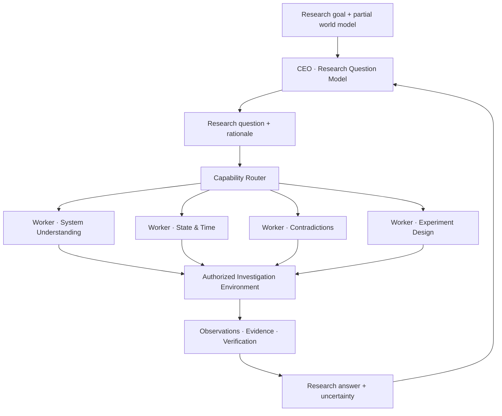

<div align="center">

# 🔬 Research Discovery Lab

### Train models to ask better questions — before the answers are known.

**An evidence-driven research arena for autonomous scientific discovery, question selection, and multi-agent investigation.**

[](#project-status)
[](#research-thesis)
[](#system-architecture)

**[Vision](#research-thesis)** · **[Architecture](#system-architecture)** · **[Learning Arena](#the-research-learning-arena)** · **[Evaluation](#evaluation-and-success-criteria)** · **[Roadmap](#roadmap)**

</div>

---

> [!IMPORTANT]
> **The goal is not to memorize exploit paths.** The goal is to develop models that recognize hidden assumptions, formulate high-value research questions, and adapt their understanding when evidence contradicts expectations.

## Research thesis

Security investigations do not always stall because investigators lack tools or execution capability. Often, the limiting factor is **which question they choose to investigate**.

Traditional benchmark-driven systems can become skilled at following known paths:

`Observation → Known pattern → Tool invocation → Expected outcome`

Research Discovery Lab explores a different loop:

**`Partial understanding → Novel question → Investigation → Evidence → Revised understanding`**

The central hypothesis is that **question-generation intelligence can be trained and measured independently from the mechanics of executing an investigation**.

A successful research model should be able to:

- Identify assumptions a system appears to rely on, including assumptions no one explicitly documented.
- Ask what changes across **time, state, identity, ordering, concurrency, component boundaries, and context**.
- Find useful contradictions between expected and observed behavior.
- Select questions whose answers could materially change the investigation.
- Learn from negative results without inventing findings.
- Generalize to unseen systems rather than reproducing published write-ups.

## System architecture

The design separates **asking**, **answering**, **routing**, **execution**, and **verification**.



### CEO — learning to ask

The **CEO** is a comparatively capable research model. It receives the research objective, a grounded snapshot of the known world, previous answers, and outstanding uncertainties.

Its job is to decide **what needs to be understood next**, not to micromanage individual tool calls.

A good CEO question is:

- **Grounded:** motivated by facts available *before* the discovery.
- **Investigable:** answerable, or meaningfully reducible, with available capabilities.
- **Discriminating:** distinguishes between competing explanations.
- **Consequential:** likely to change the researcher's understanding or next decision.
- **Open-ended in method:** does not prescribe a rigid execution path.

### Capability Router — allocating intelligence

The router is a **system capability**, not an independent truth authority or scheduler. It maps research questions to the skills, models, contexts, and resources needed to answer them.

A worker is **a research role instantiated for a task**; a model is the inference engine assigned to that role. Multiple workers may share the same small model, and a role may be reassigned to a different model as needed.

Routing should consider task requirements, measured model competence, context limits, latency, resource budgets, and escalation conditions.

### Workers — learning to answer

Workers are bounded investigators. They may plan experiments, compare hypotheses, react to intermediate observations, and request additional evidence **within the assigned research question and authorization boundaries**.

Examples of useful specializations include:

| Worker capability | Primary responsibility |
| --- | --- |
| System Understanding | Build a coherent picture of entities, behaviors, and dependencies |
| Contradiction Analysis | Compare observations with expectations and competing explanations |
| State & Temporal Reasoning | Investigate transitions, sequencing, concurrency, and stale assumptions |
| Relationship Reasoning | Examine identities, resources, trust boundaries, and interactions |
| Experimental Design | Propose controlled, informative tests and stopping conditions |
| Tool & Context Reasoning | Select appropriate available capabilities and interpret tool limitations |

Specialization is a **hypothesis to test**, not a requirement to train a separate model for every row.

### Execution and truth remain external to models

A model can **propose** a hypothesis, action, or interpretation. It does not grant itself authorization or declare a vulnerability verified.

For future HOMELAB integration, the existing ownership boundaries remain intact:

- **WorkGraph:** task state, dependencies, and recovery.
- **ActionPlane:** authorized target execution.
- **Evidence / deterministic verification:** observation provenance and truth claims.
- **Models:** reasoning, research questions, and proposed experiments.

Research Discovery Lab is a **separate training and evaluation environment**, not a replacement execution authority for HOMELAB.

## The Research Learning Arena

The arena tests whether a model can discover valuable questions in **partially observable worlds**.

Each world may contain:

- Entities, identities, resources, and relationships.
- State machines and asynchronous processes.
- Hidden rules, invariants, and trust boundaries.
- Time-dependent or order-dependent behavior.
- Multiple plausible explanations for the same observation.
- Cases with **no vulnerability at all**.

The model does **not** receive the hidden rules or final answer. It receives only information that would have been observable at that point in the investigation.

### Example episode

**Visible world snapshot**

> A document service accepts requests, authorizes them, and processes some jobs asynchronously. User permissions can change while a job is queued. No security violation has been established.

**CEO question**

> Which assumptions about authorization remain valid when the state changes between request acceptance and job completion?

**Worker investigation**

The assigned worker identifies relevant states, proposes discriminating tests, and requests observations from the arena. The arena returns results based on its hidden world rules — **not** on a predetermined solution path.

**Research answer**

The worker returns a conclusion with evidence references, uncertainty, unresolved alternatives, and any unexpected observations. The CEO then chooses whether to investigate a new question, refine the existing one, or stop.

> [!NOTE]
> An informative negative result can be a success. An unsupported positive claim is not.

## From published research to training data

Published security research provides inspiration and technical grounding, but a write-up's final solution must **never leak into the model's pre-discovery context**.

The dataset-building process distinguishes:

1. **Documented facts:** information demonstrably available at a given point in time.
2. **Reconstructed context:** plausible pre-discovery states inferred from a retrospective write-up.
3. **Hidden outcomes:** discoveries and evidence revealed only after the decision point.

Reconstructed decisions must be labeled as reconstructions, **not** attributed to the original researcher as historical fact.

### Proposed research record

```json
{
  "case_id": "example-001",
  "goal": "Understand whether authorization assumptions hold across a process",
  "snapshot": {
    "known_facts": ["Jobs can remain queued", "Permissions can change"],
    "unknowns": ["When authorization is evaluated"],
    "available_capabilities": ["Observe job state", "Run approved test"]
  },
  "ceo_question": {
    "text": "Can state changes invalidate assumptions made earlier in a job?",
    "assumption_under_test": "Authorization remains applicable throughout the job"
  },
  "provenance": {
    "context_type": "synthetic",
    "source_refs": []
  },
  "outcome": {
    "visibility": "hidden_until_evaluation",
    "status": "inconclusive"
  }
}
```

*This is an illustrative schema, not a claim that an implementation already exists.*

Potential research sources include published analyses from **XBOW, PortSwigger Research, Google Project Zero**, and other responsibly disclosed security research. Source licensing, attribution, and training permissions must be reviewed before incorporating source text.

## Learning strategy

We will **measure first, fine-tune second**.

| Stage | Purpose | Required evidence |
| --- | --- | --- |
| **0 · Baseline** | Measure untuned models on blind research episodes | Reproducible metrics and held-out worlds |
| **1 · Supervised Fine-Tuning** | Teach grounded, precise research-question formulation | Improvement beyond prompting alone |
| **2 · Preference Optimization** | Prefer useful questions over shallow, redundant, or untestable ones | Independent ranking and outcome checks |
| **3 · Reinforcement Learning** | Optimize long-horizon research value using arena outcomes | Generalization to unseen worlds and mechanisms |
| **4 · Worker Specialization** | Improve small-model answer quality where measured bottlenecks exist | Better quality/cost trade-offs than shared baselines |
| **5 · Transfer Evaluation** | Test whether learned behavior helps authorized real investigations | Verified results with controlled budgets |

The project does not assume that RL, model specialization, or a new model architecture will necessarily outperform a strong baseline. Each is an experiment.

## Reward design

Reward should reflect **what the question enabled the investigation to learn**, not whether it resembled a known write-up or contained fashionable security terms.

A proposed scoring model considers:

| Signal | Desired behavior |
| --- | --- |
| **Information gain** | Reduce uncertainty between plausible world models |
| **Decision relevance** | Change what an informed investigator should do next |
| **Grounding** | Ask questions justified by the visible evidence |
| **Discriminative power** | Separate competing explanations through observable outcomes |
| **Feasibility** | Stay within available capabilities and authorization |
| **Efficiency** | Avoid redundant, expensive, or low-value investigation |
| **Scientific integrity** | Report negative and inconclusive results accurately |

A discovered bug is **not** the only positive outcome. A question that reliably rules out a costly false lead may be valuable. A fabricated finding should never receive a positive scientific reward.

## Evaluation and success criteria

A credible result must survive **blind evaluation**.

- **Synthetic holdouts:** unseen world rules and combinations, not merely renamed training cases.
- **Research holdouts:** published cases withheld by research lineage and mechanism to reduce solution leakage.
- **Negative controls:** correctly functioning systems and deliberately misleading observations.
- **Ablations:** compare CEO-only, prompted CEO, fine-tuned CEO, specialized workers, and shared workers.
- **Matched budgets:** hold investigation time, tokens, tool access, and experiment budgets constant.
- **Transfer tests:** authorized HOMELAB investigations evaluated through existing evidence and verification contracts.

**Primary question:** Does the trained system select better research questions on unseen worlds than the same base model under the same budget?

Secondary measures include calibrated uncertainty, time to useful answer, false-positive rate, research cost, and robustness to changed names, domains, and surface details.

## Roadmap

### Phase 0 — Foundations

- [ ] Define versioned `ResearchQuestion`, `ResearchAnswer`, and `WorldSnapshot` contracts.
- [ ] Establish provenance, uncertainty, and evidence-reference requirements.
- [ ] Build deterministic tests for schema validation and information visibility.

### Phase 1 — First playable arena

- [ ] Implement a small stateful world generator and hidden-rule oracle.
- [ ] Support question → investigation → observation → answer → next question.
- [ ] Include normal, ambiguous, and adversarially confusing worlds.
- [ ] Record complete, replayable research trajectories.

### Phase 2 — Corpus and baseline

- [ ] Curate an initial set of documented research cases.
- [ ] Separate pre-discovery facts from retrospective reconstruction.
- [ ] Freeze blind evaluation splits before model training.
- [ ] Benchmark at least one untuned CEO and one baseline worker configuration.

### Phase 3 — Training experiments

- [ ] Test SFT against strong prompting and retrieval baselines.
- [ ] Evaluate preference optimization on held-out decisions.
- [ ] Explore outcome-based RL only after reward validity is demonstrated.
- [ ] Fine-tune small workers only for measured performance gaps.

### Phase 4 — HOMELAB integration

- [ ] Adapt research question/answer contracts to existing HOMELAB interfaces.
- [ ] Route worker tasks through existing capability and resource ownership.
- [ ] Preserve WorkGraph, ActionPlane, and evidence authority boundaries.
- [ ] Run controlled, authorized transfer evaluations before deployment.

## Project principles

**Questions before paths.** Investigate what matters instead of blindly replaying a known sequence.

**Discovery before exploitation.** Understand mechanisms and boundary conditions before making security claims.

**Evidence before confidence.** A plausible explanation is not a verified fact.

**Freedom in reasoning; constraints in execution.** Agents may invent hypotheses and tests, but may not bypass scope or authorization.

**No reward for hallucination.** Unknown is a valid answer.

**Measure generalization, not memorization.** Success on familiar write-ups is insufficient.

**Small models where they work.** Use routing and specialization to improve research quality per unit of compute.

## Safety and research scope

This project is intended for **authorized security research, synthetic environments, and controlled evaluations**. Research tasks and worker actions must respect explicit scope, tool permissions, rate limits, and applicable rules. Findings require independent evidence and verification; models cannot self-certify impact.

The arena may simulate risky behaviors without requiring uncontrolled execution against real targets. Real-world integration must use HOMELAB's established authorization and evidence boundaries.

## Project status

> **Early-stage research design / initial repository.** The architecture, experiments, and milestones above describe the intended direction. Do not interpret unchecked roadmap items or illustrative interfaces as shipped functionality.

## Contributing

Early contributions are most useful in **research methodology, synthetic world design, evaluation validity, dataset provenance, and reproducibility**. Please open an issue describing the hypothesis, expected observable outcome, and how the proposal avoids training/evaluation leakage.

---

<div align="center">

### Better questions. Better investigations. New discoveries.

**Research Discovery Lab** · An experimental research companion to **HOMELAB**

*The objective is not to know the answer in advance — it is to discover what is worth asking.*

</div>


## Retrieval and investigation reconstruction

Run \`python -m research_engine search "Chrome"\` or \`python -m research_engine reconstruct CASE-000001\` after \`python -m pip install -r requirements-validation.txt\`. The read-only engine assembles source-grounded timelines, negative and untried directions, challenged assumptions, question transitions, and evidence gap reports.

**Limitation:** all 50 initial records are source metadata only. A historical research trajectory is never invented from titles. See [retrieval and reconstruction documentation](docs/RETRIEVAL_ENGINE.md). Training remains the final project phase.


### Question-first research intelligence

The laboratory distinguishes **routine checklist work, apparently novel research moves, underlying research questions, and zero-day outcomes**. Grounded move-to-question links can be compared under open-ended, curated umbrella research questions. Analogy and string similarity do not become scientific equivalence automatically; unpublished or inconclusive research must not be treated as failures. See [Question-first methodology](docs/QUESTION_FIRST_RESEARCH.md).
